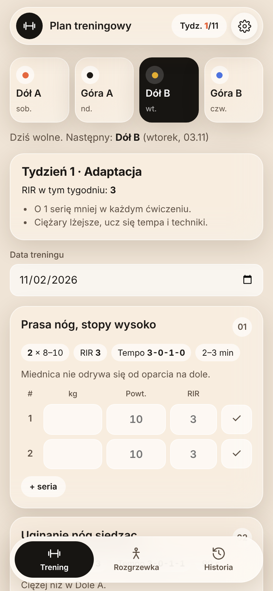
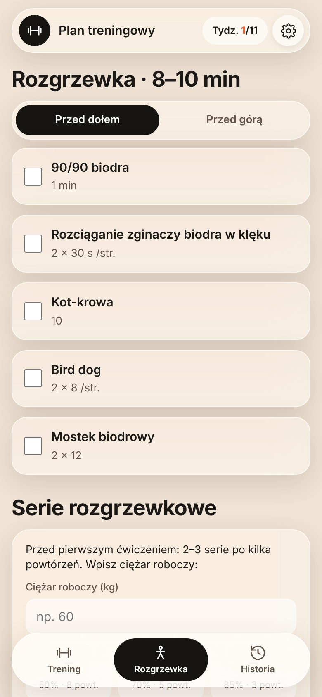
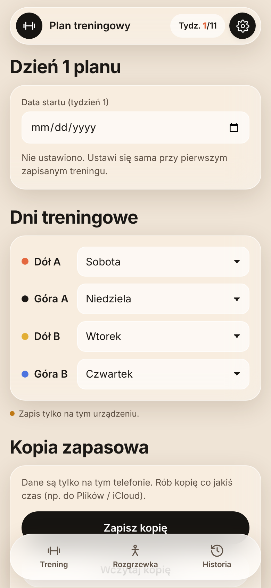

# Plan treningowy

Mobilna aplikacja webowa (PWA) do prowadzenia 11-tygodniowego planu siłowego: plan dnia z seriami do wpisania, rozgrzewka i rozciąganie, timer przerw oraz historia z wykresami progresu. Instaluje się na ekranie początkowym iPhone'a i działa **offline**, bez konta i bez serwera.

🔗 **Aplikacja:** https://afernandes24.github.io/trening/

| Trening | Rozgrzewka | Ustawienia |
|---|---|---|
|  |  |  |

## Funkcje

- 🏋️ **Plan 4-dniowy** – Dół A / Góra A / Dół B / Góra B, dni tygodnia do ustawienia
- 📈 **Periodyzacja 11 tygodni** – adaptacja, budowa, intensyfikacja i deload; liczba serii i RIR zmieniają się automatycznie
- ✍️ **Zapis serii** – kg, powtórzenia, RIR, odhaczanie serii, podpowiedź progresji na podstawie poprzedniego treningu
- ⏱️ **Timer przerw** – startuje po zaliczeniu serii, sygnał dźwiękowy, ±15 s
- 🔥 **Rozgrzewka i rozciąganie** – kalkulator serii rozgrzewkowych z ciężaru roboczego, checklisty
- 📊 **Historia** – lista treningów i wykres progresu każdego ćwiczenia
- 🩺 **Skala bólu pleców** – zapisywana po każdym treningu
- 💾 **Kopia zapasowa** – eksport/import danych do pliku JSON
- 🌙 **Tryb ciemny** – zgodny z ustawieniami systemu

## Technologie

| Warstwa | Stack |
|---|---|
| Frontend | HTML, CSS, JavaScript (bez frameworków, jeden plik) |
| Dane | Local Storage w przeglądarce + eksport/import JSON |
| PWA | Web App Manifest, Service Worker (cache offline) |
| Hosting | GitHub Pages |

## Struktura

```
index.html             aplikacja (UI, logika planu, zapis danych)
manifest.webmanifest   nazwa, ikony, tryb pełnoekranowy
sw.js                  service worker – działanie offline
icon-*.png             ikony aplikacji
```

## Instalacja na iPhonie

1. Otwórz link do aplikacji w **Safari**
2. **Udostępnij → Do ekranu początkowego**

## Uruchomienie lokalne

```bash
python3 -m http.server 8000
```

Aplikacja: **http://localhost:8000**
